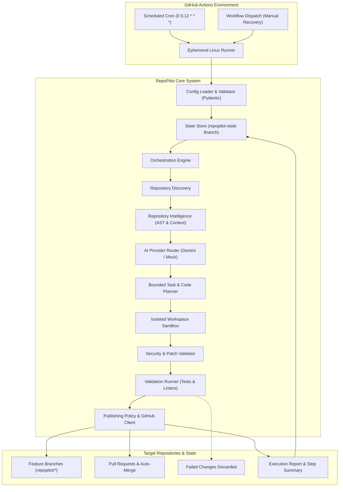

# RepoPilot: System Architecture

RepoPilot is an autonomous, zero-cost GitHub repository management and development agent built for unattended execution on GitHub Actions.

---

## 1. Architectural Principles

1. **Zero-Cost Operation (₹0)**: Every subsystem utilizes free-tier GitHub infrastructure, free AI inference (Google Gemini Free Tier / local mock), and native Git storage. No paid servers or SaaS subscriptions.
2. **Strict Trust Boundaries**: All repository code, issues, PR descriptions, and AI-generated outputs are treated as **untrusted inputs**.
3. **Repository-Level Fault Isolation**: A fatal exception or misconfiguration in one repository never halts processing of other repositories.
4. **Mandatory Automated Verification**: AI proposals cannot bypass tests or lint checks. If tests fail after bounded retries, the change is discarded.
5. **Durable, Stateless Execution**: Runners are ephemeral, but task history and state persist durably via an isolated Git state branch (`repopilot-state`).

---

## 2. High-Level Component Diagram



---

## 3. Autonomous Execution Lifecycle (17 Steps)

The orchestrator executes the following bounded loop:

1. **Boot**: GitHub Actions initiates runner with minimal permissions and strict timeout.
2. **Config Validation**: Load and validate `config/repos.yaml` against schema constraints.
3. **Restore State**: Fetch durable state from `repopilot-state` branch or local storage.
4. **Discover Repositories**: Identify enabled target repositories within execution budget.
5. **Inspect Context**: Analyze file tree, technology stack, package managers, and open issues.
6. **Identify Improvements**: Query AI provider for small, high-confidence, non-breaking tasks.
7. **Deduplication Check**: Cross-reference proposed tasks with persistent task history.
8. **Bounded Implementation Plan**: Formulate structured `ChangePlan` for eligible tasks.
9. **Workspace Isolation**: Stage repository into an ephemeral temporary workspace directory.
10. **Defensive Patch Application**: Validate paths against traversal (`../`) and forbidden lists (`.github/workflows/`, secrets).
11. **Automated Validation**: Execute tests and lint checks with sanitized environment (no credentials).
12. **Bounded Repair**: On test failure, feed error output back to AI for up to `max_retries_per_task`.
13. **Safety Discard**: If validation fails after maximum retries, discard changes completely.
14. **Publishing**: Create branch and publish PR (or draft PR) according to repository policy.
15. **Conditional Merge**: If `auto_merge: true` is explicitly configured and all checks pass, merge PR.
16. **Record Outcomes**: Save task completion, branch URL, and duration to persistent memory.
17. **Report & Cycle**: Generate GitHub Actions Step Summary and proceed to next repository.

---

## 4. Module Decomposition

```
src/repopilot/
├── core/             # Immutable domain models, exceptions, sanitizing logger, budget tracker
├── config/           # Pydantic schema validation, security restrictions, defaults
├── github/           # GitHub REST API client, mock client, models for PRs, issues, commits
├── intelligence/     # AST inspection, language & framework detection, doc discovery
├── ai/               # AI provider abstraction, Gemini free tier, deterministic mock, router
├── execution/        # Isolated workspace sandboxing, defensive patch application
├── validation/       # Test & lint runner with environment secret scrubbing
├── orchestration/    # Multi-repo lifecycle manager, fault isolation, budget enforcement
├── state/            # Git branch state store, atomic file store, task deduplication
└── reporting/        # GitHub Step Summary markdown generator, JSON metrics reporter
```
